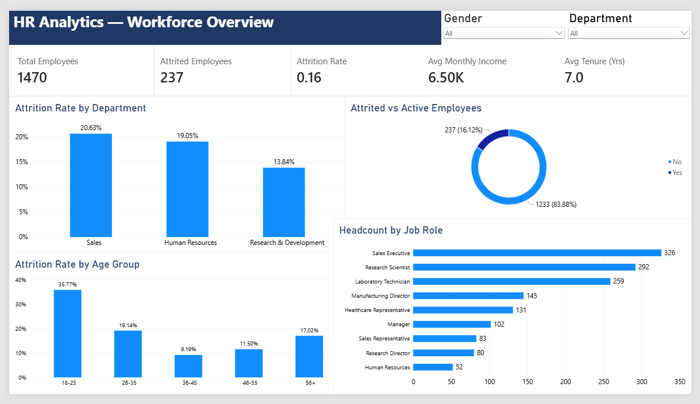
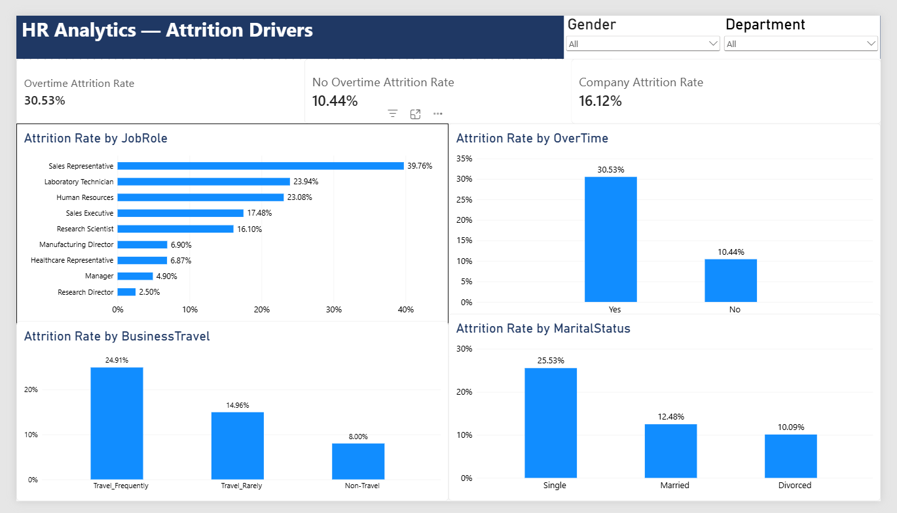
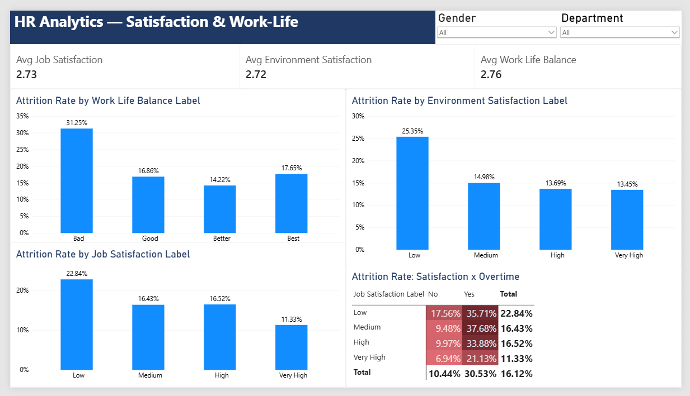
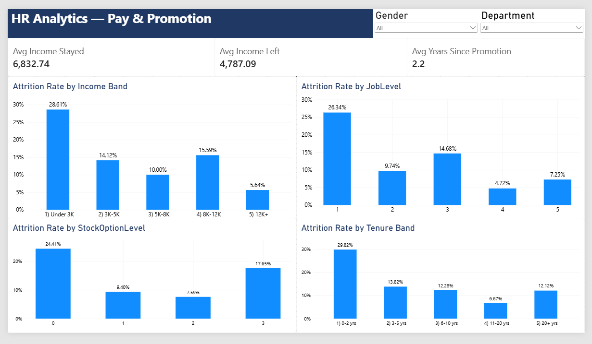

# HR Attrition Analytics: Power BI Dashboard

An interactive 4-page Power BI report that explains **who leaves, why, and where retention effort should go first**, using IBM's HR Analytics dataset (1,470 employees).

## Business Problem

Employee turnover is expensive: recruitment, training time and lost productivity. HR leadership needs to know which employees are most at risk, what is driving it, and which factors the company can actually change.

## Dataset

- **Source:** [IBM HR Analytics Attrition Dataset (Kaggle)](https://www.kaggle.com/datasets/pavansubhasht/ibm-hr-analytics-attrition-dataset)
- **Size:** 1,470 employees, 35 columns
- **Note:** This is a fictional dataset created by IBM data scientists for teaching purposes, not real company data.

## Dashboard Pages

### 1. Workforce Overview
*How big is the problem, and where does it start?*



- 237 of 1,470 employees left, an attrition rate of **16.1%**
- Sales (20.6%) and HR (19.1%) lose more people than R&D (13.8%)
- Employees aged 18-25 leave at **35.8%**, more than double the company rate

### 2. Attrition Drivers
*What is driving it?*



- Overtime workers leave at **30.5%** vs **10.4%** without overtime
- Frequent travellers: 24.9% vs 8.0% for non-travellers
- Single employees: 25.5% vs 10.1% for divorced
- Sales Representatives lead job roles at 39.8%; Research Directors sit at 2.5%

### 3. Satisfaction & Work-Life
*Is unhappiness the cause?*



- Poor work-life balance: 31.3% attrition; low environment satisfaction: 25.4%
- Low job satisfaction roughly doubles attrition (22.8% vs 11.3% at Very High)
- **Overtime outweighs satisfaction:** highly satisfied employees working overtime leave at 21.1%, more than dissatisfied employees on normal hours (17.6%)

### 4. Pay & Promotion
*Do people leave because they feel underpaid or stuck?*



- Under 3K monthly income: 28.6% attrition vs 5.6% above 12K
- Job level 1: 26.3%; first two years of tenure: 29.8%
- Employees with no stock options: 24.4%
- Leavers earned about 30% less on average than stayers (4,787 vs 6,833)

## Key Takeaway

Retention risk is concentrated among **new, junior, overtime-heavy employees**, especially in Sales. Reducing overtime is likely the strongest first step, ahead of satisfaction programmes alone.

## Data Preparation (Power Query)

- Removed three constant columns: `EmployeeCount`, `Over18`, `StandardHours`
- Set `EmployeeNumber` to text and checked for nulls and errors (none found)
- Validated totals against the source: 1,233 stayed, 237 left

## DAX Measures (17)

| Group | Measures |
|---|---|
| Headcount | Total Employees, Attrited Employees, Active Employees, Attrition Rate |
| Profile | Avg Monthly Income, Avg Age, Avg Tenure, Avg Years Since Promotion |
| Satisfaction | Avg Job Satisfaction, Avg Environment Satisfaction, Avg Work Life Balance |
| Drivers | Overtime Attrition Rate, No Overtime Attrition Rate, Company Attrition Rate, Attrition vs Company |
| Pay | Avg Income Left, Avg Income Stayed |

Example:

```
Attrition Rate = DIVIDE([Attrited Employees], [Total Employees])
```

## Limitations

- **Small groups:** some segments have few employees (for example, about 83 Sales Representatives), so their percentages move easily. Tooltips show headcount beside each rate.
- **Overlapping factors:** pay, job level and tenure move together, so the data cannot separate their effects.
- **Association, not cause:** this is a single snapshot, so the findings show patterns rather than proof of cause.
- **Fictional data:** results illustrate the method, not a real organisation.

## Tools

Power BI Desktop, Power Query, DAX


## How to Use

1. Download `HR_Attrition_Analysis.pbix` and open it in [Power BI Desktop](https://powerbi.microsoft.com/desktop/) (free).
2. Use the **Department** and **Gender** slicers. They sync across all four pages.
3. Click any bar to cross-filter the other visuals on the page.
4. Hover over a bar to see the headcount behind each rate.

## Author

**Rudra M. Upadhyay**
